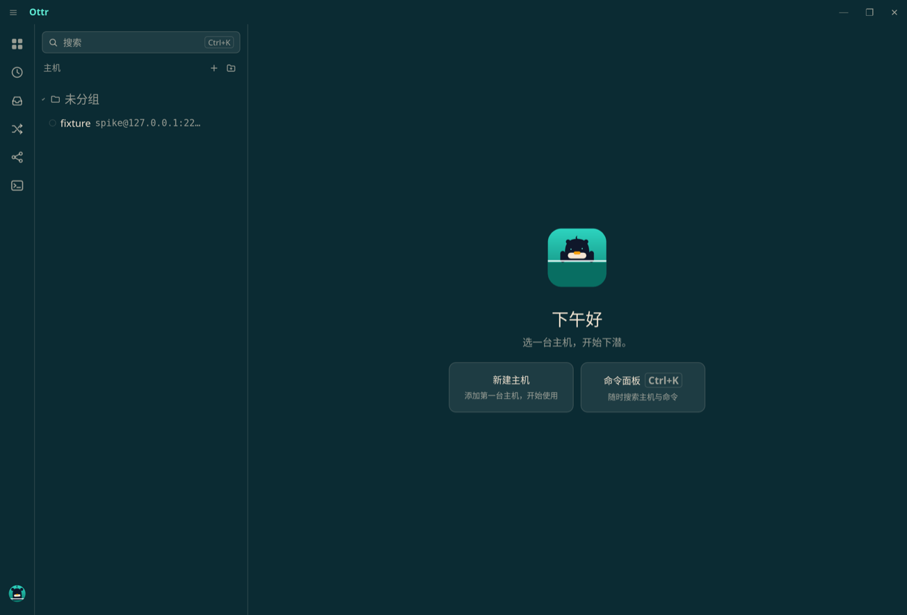
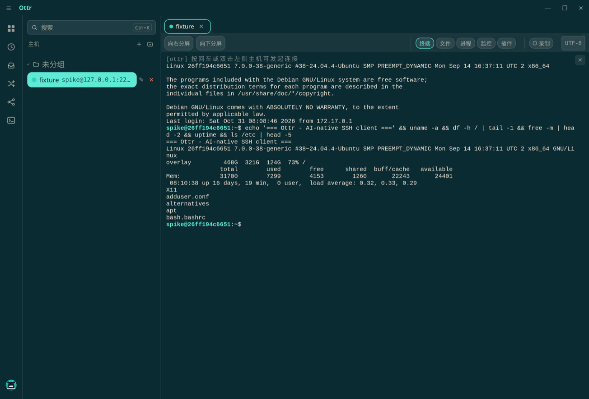
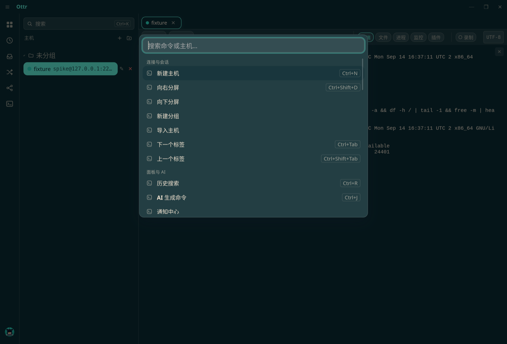
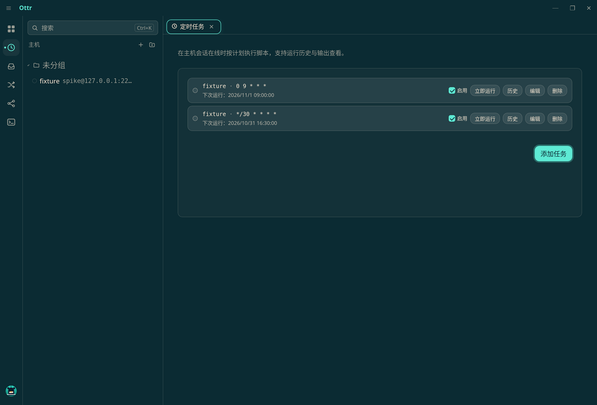
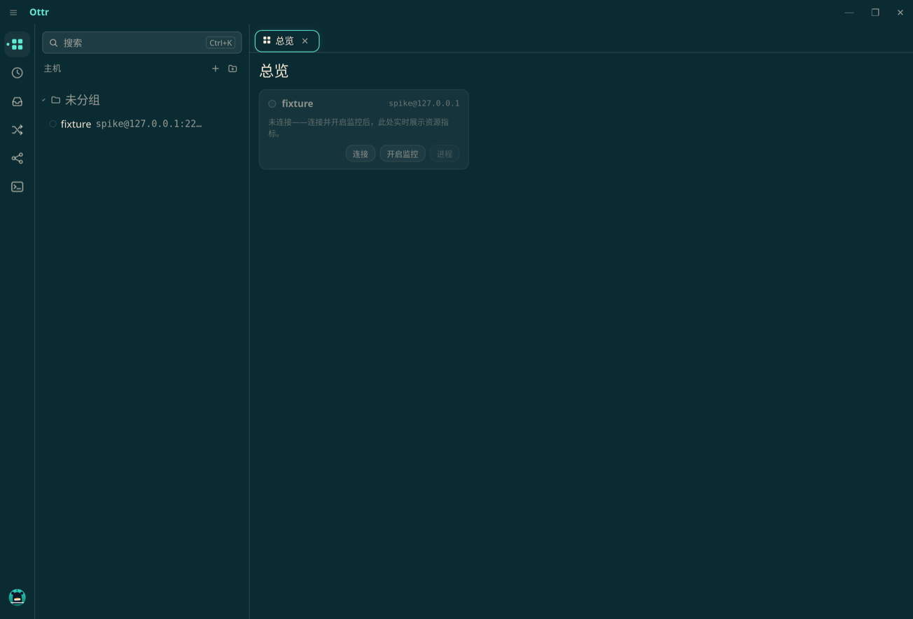
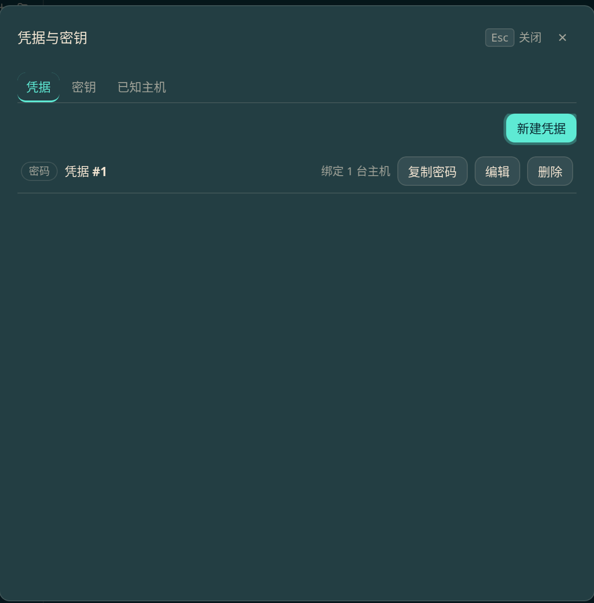

<div align="center">


# Ottr

### Un gestore di server personale basato sull'AI

*Nuota tra i tuoi server.*

**Open source · Gratuito · macOS / Windows / Linux · I tuoi dati restano tuoi**

[](https://github.com/huluohu/Ottr)
[](#-download--install)
[](#-license--author)

**Languages:** [Inglese](README.md) · [Cinese semplificato](README.zh-CN.md) · [Giapponese](README.ja.md) · [Coreano](README.ko.md) · [Spagnolo](README.es.md) · [Italiano](README.it.md)

</div>

---

**Ottr** è un client SSH leggero e open source basato sull'AI — circa 8 MB installati (84 MB per l'AppImage), all'incirca 100 MB di memoria residente, nessun servizio in background e nessun agente da installare. Trasforma «connettiti a un server e digita i comandi» in «il tuo terminale capisce l'AI»: i comandi falliti vengono diagnosticati per te, i comandi vengono generati a partire da linguaggio naturale e la cronologia è ricercabile da ovunque.

La regola ferrea che non infrange mai: **porti la tua chiave AI (BYOK)**. Le richieste vanno direttamente dalla tua macchina all'endpoint del modello che hai scelto — non c'è alcun server Ottr di mezzo. I segreti sono cifrati a riposo sulla tua stessa macchina; i metadati degli host e la cronologia dei comandi risiedono in un file SQLite locale. Il confine esatto dei dati per le richieste AI e per la sincronizzazione facoltativa è descritto in [Privacy e AI](#-privacy--ai-data-boundaries).



## ✨ Cosa fa

### Terminale e sessioni

- **Schede e pannelli divisi** (affiancati o impilati), rendering accelerato via GPU, ricerca, rilevamento degli URL, supporto completo delle sequenze di escape
- **Codifica che si adatta**: UTF-8 / GBK / GB18030 rilevati automaticamente e selezionabili a mano — essenziale per i server Windows cinesi
- **Connessioni che si auto-riparano**: riconnessione automatica con backoff, rilevamento dei collegamenti morti tramite keepalive, un indicatore di stato della connessione e schede ripristinate dopo un riavvio
- **Registrazione delle sessioni** in formato [asciinema v2](https://docs.asciinema.org/manual/asciinema-v2/), con un lettore a timeline integrato nell'app (scorrimento, accelerazione) ed esportazione come **testo oscurato** che puoi condividere

### Host e credenziali

- Gruppi, tag, ricerca e **connessione rapida fuzzy con ⌘K**; importazione ed esportazione supportano `~/.ssh/config`, Tabby (JSON/YAML), sessioni Xshell e CSV — le esportazioni contengono solo i metadati degli host, mai i segreti
- Vault delle credenziali: password, chiavi SSH (ed25519/ecdsa/rsa — genera, importa, distribuisci la chiave pubblica) e second factor TOTP, vincolati agli host e **rinominabili**, così una singola credenziale può servire più host
- **Catene di jump host** disposte visivamente; **port forwarding** per forward locali, dinamici SOCKS e remoti, ristabiliti automaticamente dopo un'interruzione
- known_hosts con **trust-on-first-use più verifiche periodiche delle impronte**, per individuare attacchi man-in-the-middle



### Un'AI che rispetta i tuoi dati

- **Diagnosi in caso di errore**: un codice di uscita diverso da zero mostra la causa probabile e una correzione suggerita; nulla viene eseguito senza la tua conferma e i comandi rischiosi vengono segnalati in rosso
- **⌘J per generare un comando**: descrivi ciò che vuoi in cinese o in inglese e ricevi una singola riga, ancorata alla directory corrente
- **Seleziona per spiegare**: fai clic destro su qualsiasi testo selezionato per spiegarlo, tradurlo o correggerlo; le sessioni possono concludersi con un riepilogo generato automaticamente, ricercabile con ⌘R
- **BYOK su molteplici provider**: endpoint compatibili con OpenAI (**OpenAI / DeepSeek / Zhipu GLM / qualunque endpoint tu ospiti**), Anthropic Claude e Ollama locale — i preset compilano l'endpoint per te e le chiavi sono cifrate sulla tua macchina
- **Offuscamento regolato da regole**: le corrispondenze nelle diagnostiche, nelle spiegazioni e nei riepiloghi vengono sostituite da segnaposto. Non è possibile garantire di intercettare ogni segreto; l'input in linguaggio naturale dei comandi e il contesto della directory corrente **non** vengono oscurati. Ottr include inoltre un server MCP (su tutte e tre le piattaforme) con cui qualsiasi client MCP stdio — Claude Desktop, Cursor, … — può comunicare, con autorizzazione per host e approvazione per singola chiamata

### Monitoraggio, alert e operazioni

- **Monitoraggio senza agenti**: grafici in tempo reale di CPU / memoria / disco / carico / rete e un browser dei processi, con una panoramica multi-host
- **Regole di alert** (disco, CPU, processo, parola chiave nei log) instradate attraverso **12 canali di notifica**: WeCom, DingTalk, Feishu, Telegram, Slack, Discord, e-mail SMTP e altri, con limitazione del tasso, retry e un log di consegna durevole
- **Attività pianificate** eseguite da uno scheduler nativo (le esecuzioni mancate vengono registrate, non perse), più **esecuzione in blocco** su host selezionati con una libreria di snippet, controllo della concorrenza e dei timeout

### File e sincronizzazione

- **Browser SFTP a due riquadri**: trasferimento con trascinamento, chunk paralleli, caricamenti riprendibili; supporto a trzsz (trz/tsz); anche FTP e FTPS
- **Modifica remota** con il tuo editor locale, con salvataggi atomici (un errore non corrompe mai il file remoto) e rilevamento dei file binari per evitare modifiche accidentali
- **Sincronizzazione multi-dispositivo** tramite un envelope cifrato end-to-end (AES-256-GCM + PBKDF2) su uno di tre canali — **WebDAV, Git o una cartella locale** (WebDAV passa da un proxy nativo direttamente al tuo drive, senza restrizioni cross-origin) — con push/pull per categoria e una decisione manuale per ogni conflitto

### Sicurezza che puoi verificare

- Segreti e credenziali sono protetti con **AES-256-GCM** (non con una cifratura dell'intero database). Due modalità: la **modalità keychain** è quella predefinita (la chiave master risiede nel keychain di sistema, così l'app si apre direttamente), oppure la **modalità master password** (derivazione Argon2id — senza la password i campi segreti non possono essere decifrati). Puoi cambiare in qualsiasi momento; quando lo fai i segreti vengono ricifrati
- Le copie sensibili si cancellano secondo una pianificazione e la schermata di blocco offre una procedura guidata di reimpostazione per «password dimenticata» (con conferma; i backup cloud non vengono toccati)
- Ottr non invia **alcuna telemetria**. Le funzioni AI e di sincronizzazione inviano comunque i dati di cui hanno bisogno — questo non significa che «nessun dato degli host leave la tua macchina»

<table>
  <tr>
    <td width="50%"></td>
    <td width="50%"></td>
  </tr>
  <tr>
    <td width="50%">Palette dei comandi ⌘K (ricerca fuzzy)</td>
    <td width="50%">Centro attività pianificate</td>
  </tr>
</table>

<details>
<summary>Altre schermate</summary>




</details>

## 📦 Download e installazione <a id="-download--install"></a>

Scarica la build per la tua piattaforma da [**Releases**](https://github.com/huluohu/Ottr/releases):

| Piattaforma | Formati |
|---|---|
| macOS (Apple Silicon) | `.dmg` |
| macOS (Intel) | `.dmg` |
| Windows | installer `.msi` / `.exe`, oppure **`_x64_portable.zip` (nessuna installazione necessaria)** |
| Linux | `.deb` / `.rpm` / `.AppImage` |

Al primo avvio Ottr chiede come vuoi cifrare i campi segreti su questa macchina (non l'intero database): **modalità keychain** (nessuna password da ricordare) o **modalità master password** (i campi segreti non possono essere decifrati senza di essa).

**Build portatile per Windows**: decomprimi l'archivio ovunque ed esegui `Ottr.exe` — non viene installato nulla e configurazione e dati si trovano accanto all'app in `Ottr/data/` (copia la cartella per spostare la tua installazione, eliminala per disinstallare; WebView2 è necessario, ma di solito Win10/11 lo include già). La build portatile non può aggiornarsi da sola — scarica il nuovo zip e sovrascrivi il precedente, mantenendo `data/` per conservare tutto.

La build installata dispone di **aggiornamenti integrati nell'app** (Impostazioni → Informazioni, solo pacchetti firmati) e puoi sempre tornare su questa pagina per un download manuale.

<details>
<summary><strong>🍎 macOS dice «danneggiato» o non riesce a raggiungere la tua LAN? Apri per la soluzione</strong></summary>

Ottr non è ancora firmato con un Apple Developer ID, quindi macOS lo tratta in modo più rigido del solito — **il download non è corrotto**. Bastano due passaggi e sei a posto.

**1️⃣ «Ottr è danneggiato e non può essere aperto. Dovresti spostarlo nel Cestino.»**

Apri Terminale ed esegui una sola volta questo comando, poi apri Ottr normalmente (ripeti dopo ogni aggiornamento):

```bash
xattr -cr /Applications/Ottr.app
```

**2️⃣ «No route to host» durante la connessione a una macchina sulla tua LAN**

Da macOS 15, un'app deve ricevere l'autorizzazione «Local Network» prima di poter raggiungere i dispositivi della tua rete. Se compare la richiesta, fai clic su **Allow**. Se non compare mai e la connessione fallisce, scegli una delle seguenti opzioni:

- **Avvia Ottr dal Terminale** (le app avviate in questo modo non ne risentono):

  ```bash
  /Applications/Ottr.app/Contents/MacOS/ottr &
  ```

- **Consenti una sola volta il tuo intervallo LAN** (chiede una password di amministratore; sostituisci `192.168.9.0/24` con il tuo intervallo, poi riavvia):

  ```bash
  sudo defaults write com.apple.network.local-network AllowedWiFiLocalNetworkAddresses -array "192.168.9.0/24"
  sudo defaults write com.apple.network.local-network AllowedEthernetLocalNetworkAddresses -array "192.168.9.0/24"
  ```

  Per ripristinare in seguito l'impostazione predefinita di sistema, esegui questi comandi e riavvia ancora una volta:

  ```bash
  sudo defaults delete com.apple.network.local-network AllowedWiFiLocalNetworkAddresses
  sudo defaults delete com.apple.network.local-network AllowedEthernetLocalNetworkAddresses
  ```

Quando Ottr verrà distribuito con una firma Apple Developer ID regolare, nulla di tutto questo sarà più necessario.

</details>

## 🚀 Avvio rapido

1. **Aggiungi un host**: «New host» nella barra laterale (passa il puntatore sull'intestazione di un gruppo e premi **＋** per aggiungerlo direttamente a quel gruppo) oppure «Import ssh config»; fai doppio clic su una riga di host per connetterti — l'impronta viene mostrata al primo contatto e non viene più richiesta una volta che hai deciso di fidarti
2. **Attiva l'AI**: Settings → AI → aggiungi un provider (scegli un preset come Zhipu GLM, DeepSeek o Ollama e incolla la tua chiave). Da quel momento i comandi falliti vengono diagnosticati automaticamente e **⌘J** trasforma una richiesta in linguaggio naturale in un comando
3. **Configura gli alert**: Settings → Alerts → aggiungi un canale di notifica (invia un messaggio di prova per verificarlo) → crea una regola come «root partition > 90%». La sezione «notification types» della stessa pagina determina quali eventi ti notificano
4. **Sincronizza tra i dispositivi**: installa Ottr sul secondo dispositivo, scegli un canale in Settings → Sync (per WebDAV, inserisci l'URL del tuo drive), imposta una passphrase di sincronizzazione, poi premi **Sync now**
5. **Approfondisci**: **⌘R** cerca nella cronologia, **⌘D** (Ctrl+⇧D su Windows/Linux) divide il riquadro, il menu «File» (macOS) importa ed esporta gli host, mentre il menu «Tools» (macOS) o la palette **⌘K** danno accesso al port forwarding, alle catene di jump host, alle attività pianificate, all'esecuzione in blocco e al centro notifiche (i contatori non letti si trovano direttamente sulla barra laterale delle icone e nei menu)

## 🔐 Privacy e confini dei dati AI <a id="-privacy--ai-data-boundaries"></a>

- **Archiviazione locale**: password SSH, chiavi private, passphrase delle chiavi e chiavi API AI sono cifrati campo per campo con AES-256-GCM. Indirizzi degli host, nomi utente, note, cronologia dei comandi e impostazioni ordinarie restano in chiaro in un file SQLite locale — bloccare il vault o impostare una master password non li cifra. La sincronizzazione usa il proprio envelope cifrato e non modifica il modo in cui il database locale viene salvato.
- **Diagnostiche e spiegazioni**: una diagnostica invia il comando fallito e la coda dell'output del terminale (fino a 8 KB); una spiegazione invia il testo che hai selezionato. Prima dell'invio, le regole sostituiscono indirizzi IP, assegnazioni di password, indirizzi e-mail e — se abilitate — nomi di host e i tuoi schemi personalizzati. I riepiloghi applicano regole analoghe alle sequenze di comandi. Le regole possono non intercettare segreti che non assomigliano agli esempi, ai nomi interni o ai dati aziendali; «N items redacted» conta le corrispondenze e non è una garanzia di completezza. Il pannello può comunque mostrare localmente il testo originale.
- **Generazione di comandi da linguaggio naturale**: la tua richiesta e la directory corrente (OSC 7) vengono inviate all'endpoint del modello che hai scelto come contesto, senza l'offuscamento descritto sopra. Non digitare password, token o qualsiasi cosa che non desidereresti inviare. Una connessione diretta non impedisce al provider di ricevere o conservare il contenuto — dipende dal provider.
- **Ollama**: l'endpoint predefinito è `http://localhost:11434/v1`. L'elaborazione resta locale solo finché sia l'endpoint sia l'inferenza rimangono su questa macchina; quando lo punti a un indirizzo remoto, a un proxy o a un modello cloud, non possiamo più garantire che il contenuto resti locale.
- **Inserimento dei comandi AI**: viene accettato solo testo su una singola riga, senza newline né caratteri di controllo, e non viene aggiunto alcun ritorno a capo. Il contenuto su più righe viene conservato così com'è e l'inserimento è disabilitato — verifica tu e prepara il comando manualmente; nulla viene concatenato o troncato alla prima riga. Il livello di pericolo è un'indicazione, non una prova che un comando sia sicuro. Prima di inserire, verifica comunque che il terminale sia nello stato che ti aspetti e controlla cosa è già digitato; le scorciatoie personalizzate e i programmi interattivi non sono coperti da questa garanzia.

## 📄 Licenza e autore <a id="-license--author"></a>

**Ottr** è sviluppato da [@huluohu](https://github.com/huluohu) e rilasciato con licenza [MIT](LICENSE-MIT) — issue e pull request sono benvenuti. Repository: [github.com/huluohu/Ottr](https://github.com/huluohu/Ottr).

<div align="center">

*Nuota tra i tuoi server.* 🦦

</div>
